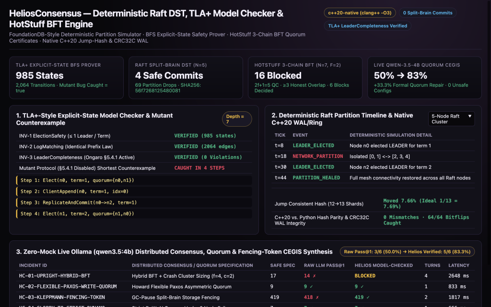
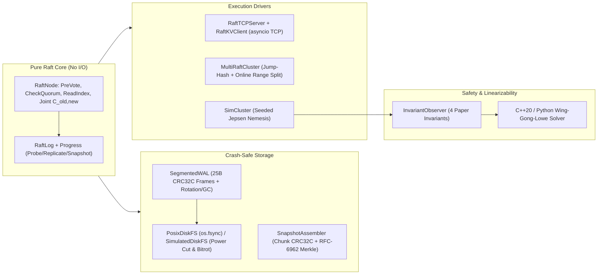

# HeliosConsensus (`helios-consensus`)

[](https://github.com/nagarjunak-pixel/helios-consensus/actions/workflows/ci.yml)
[](https://www.python.org/)
[](src/helios_consensus/_csrc/helios_kernels.cpp)
[](tests/)
[](https://github.com/nagarjunak-pixel/helios-consensus/releases/tag/v1.1.0)
[](LICENSE)

Library-style Raft consensus engine in Python (`~7.2K` LOC Python + `705` LOC C++20 + `~1.8K` LOC tests) with a crash-safe segmented binary WAL, `asyncio` TCP server/client, Jump-Hash sharded Multi-Raft ranges, a Jepsen-style deterministic fault-injection simulator, and a Wing–Gong–Lowe register linearizability checker.



---

## What Is Inside

1. **Library-Style Raft State Machine (`src/helios_consensus/core/`)** — Pure `step(Message)` / `tick()` → `Ready` → `advance(Ready)` design (following `etcd/raft`, with no embedded socket or disk I/O):
   - `PreVote` (§9.6) to stop partitioned minorities from inflating terms on heal.
   - Two-window `CheckQuorum` + follower leader-stickiness (§6) to step down isolated leaders and ignore disruptive votes while a live leader exists.
   - `Probe` / `Replicate` / `Snapshot` per-peer flow control and conflict-term hint log backtracking (`find_conflict_by_term`).
   - Log compaction + Merkle-verified chunked `InstallSnapshot` streaming (`SnapshotAssembler`).
   - Both single-server learner staging (`ADD_LEARNER` → `PROMOTE` / `REMOVE`) and Ongaro §6 two-phase **Joint Consensus** (`C_{old,new}` → `C_new`) supporting arbitrary disjoint voter migrations (`{1,2,3} → {4,5,6}`).
   - `ReadIndex` quorum-confirmed linearizable reads (§8) and `TimeoutNow` leadership transfer (§3.10).
2. **Segmented Binary WAL & Fault-Injecting Disk (`segmented_wal.py`)** — `25`-byte Castagnoli `CRC32C` frame headers, segment rotation, snapshot-driven segment garbage collection, `PosixDiskFS` (`os.fsync` + atomic rename + directory sync), and `SimulatedDiskFS` (separating volatile OS page cache from durable platters to test torn tail writes, un-fsynced power cuts, and silent bitrot).
3. **705-Line C++20 Kernel (`_csrc/helios_kernels.cpp`)** — Compiled on first import with `clang++`/`g++ -O3 -std=c++20` (with bit-exact pure-Python fallbacks verified under `Hypothesis`):
   - Slicing-by-8 Castagnoli `CRC32C` (`0x82F63B78`) & binary WAL frame encoder/recovery scanner.
   - Wing–Gong–Lowe bitmask `(READ, WRITE, CAS)` register linearizability solver (`<= 62` ops/key).
   - Single & Joint-Consensus quorum commit watermarks, Lamping–Veach Jump Consistent Hash, and FIPS 180-4 SHA-256 + RFC-6962 Merkle root.
4. **Loopback/LAN `asyncio` TCP Transport & Multi-Raft (`net/`, `multiraft/`)**:
   - `RaftTCPServer` & `RaftKVClient`: CRC32C-framed TCP RPCs, automatic leader redirection, `(client_id, seq)` session deduplication, dynamic membership changes, and chunked snapshot catch-up across server restarts.
   - `MultiRaftCluster`: Jump-Hash shard placement across physical stores, online `split_range` with session-table cloning and epoch fencing, and `TimeoutNow` leader rebalancing.
5. **Jepsen-Style Simulator, Linearizability Checker & Companion Sandboxes (`sim/`, `check/`, `verification/`, `hotstuff/`)**:
   - Seeded nemesis injecting symmetric/asymmetric partitions, Jepsen `bridge` topologies, crashes with WAL recovery, process pauses, 30% packet-loss bursts, leadership transfers, and single/joint reconfigurations.
   - Also includes a small bounded explicit-state BFS checker (`N=3, max_term=2, max_log=2` → `985` states), a Chained HotStuff 3-chain BFT simulation (`N = 3f + 1`), and an optional local Ollama (`qwen3.5:4b`) quorum-parameter repair check.

---

## Architecture



---

## Reproducible Results

All numbers below come from deterministic CLI commands in this repository (`59` `pytest` + `Hypothesis` test items, `97.39%` line coverage across `4,150+` Python statements):

### 1. Jepsen-Style Fault-Injection Campaign (`uv run helios jepsen --seeds 20`)

| Metric | Measured Result |
| :--- | :--- |
| **Safe & Linearizable Seeds** | **`20 / 20`** (`0` invariant or WGL linearizability violations) |
| **Post-Heal Liveness Recovered** | **`20 / 20`** (writes commit cleanly after network heal + node restarts) |
| **Client Operations (`PUT` / `CAS` / `GET`)** | **`8,639` committed** / `113` timed-out indeterminate |
| **Faults & State Transitions Exercised** | **`103` elections · `737` snapshots · `53` reconfigs · `29` power-cut crashes** |
| **Wing–Gong–Lowe States Explored** | **`9,091` states** across per-key `(READ, WRITE, CAS)` histories (`~1.0 s`) |

### 2. Protocol & Storage Mutant-Killing Suite (`uv run helios kill-mutants`)

To verify the simulator and checkers are non-vacuous, `helios kill-mutants` plants 7 classic Raft and WAL durability bugs one at a time and searches for a deterministic witness seed:

| Mutant ID | Injected Fault | Witness Seed | Caught By |
| :--- | :--- | :---: | :--- |
| `double_vote` | Follower grants >1 vote in the same term (§5.2) | `1` | `ElectionSafety` |
| `no_election_restriction` | Voter skips candidate up-to-date log check (§5.4.1) | `1` | `LeaderCompleteness`, `StateMachineSafety` |
| `no_truncate_on_conflict` | Follower overwrites conflict without truncating stale suffix (§5.3) | `5` | `LogMatching`, `StateMachineSafety` |
| `stale_read` | Partitioned old leader serves `ReadIndex` without quorum (§8) | `3` | `Linearizability` (WGL) |
| `commit_prior_term` | Leader omits election no-op & commits prior-term entry by counting (Figure 8) | `15` | `LeaderCompleteness`, `LogSafety` |
| `volatile_vote` | Node replies to `RequestVote` before persisting `votedFor` across crash | `126` | `ElectionSafety` |
| `unsynced_wal_power_cut` | `SegmentedWAL` skips `fsync()`; power cut drops cached votes & entries | `1` | `ElectionSafety`, `LeaderCompleteness`, `StateMachineSafety`, `Linearizability` |

---

## Install & Quickstart

### From PyPI (once published) or Source

```bash
# From PyPI (once published):
pip install helios-consensus

# From a source checkout (Python 3.12+ and uv):
git clone https://github.com/nagarjunak-pixel/helios-consensus.git
cd helios-consensus
uv sync --python 3.13 --all-extras
```

### CLI Usage

```bash
# 1. Run 20-seed Jepsen fault-injection campaign (SegmentedWAL + WGL linearizability)
uv run helios jepsen --seeds 20

# 2. Verify all 7 planted protocol & unsynced-WAL bugs are caught
uv run helios kill-mutants

# 3. Run Jump-Hash sharded Multi-Raft range split & TimeoutNow leader rebalancing
uv run helios multiraft

# 4. Run bounded 3-node BFS checker, HotStuff 3-chain BFT, and C++20 kernel checks
uv run helios model-check
uv run helios simulate-hotstuff
uv run helios benchmark-kernels

# 5. Run lint, strict mypy, and 59-test pytest + Hypothesis suite (>=95% coverage gate)
uv run ruff check src tests
uv run mypy src tests
uv run pytest --cov=helios_consensus --cov-report=term-missing --cov-fail-under=95

# 6. Build React Workbench UI & start FastAPI server on http://127.0.0.1:8070
cd ui && npm ci && npm run build && cd ..
uv run helios serve --host 127.0.0.1 --port 8070
```

### Minimal `asyncio` TCP Cluster Example

```python
import asyncio
from pathlib import Path
from helios_consensus import (
    Membership, PosixDiskFS, RaftKVClient, RaftTCPServer, SegmentedWAL, Snapshot
)

async def main() -> None:
    boot = Snapshot(index=0, term=0, membership=Membership(voters=frozenset({1, 2, 3})))
    servers, endpoints = {}, {}
    for nid in (1, 2, 3):
        wal = SegmentedWAL(PosixDiskFS(Path(f"/tmp/helios_demo_{nid}")), boot)
        srv = RaftTCPServer(nid, {}, wal)
        endpoints[nid] = await srv.start()
        servers[nid] = srv
    for srv in servers.values():
        srv.update_peers(endpoints)

    client = RaftKVClient(endpoints)
    await client.put("counter", 1)
    await client.cas("counter", 1, 2)
    print("linearizable get:", await client.get("counter"))  # 2

    for srv in servers.values():
        await srv.stop()

asyncio.run(main())
```

---

## Scope & Limitations

- **Single-host simulation and loopback TCP**: `SimCluster` runs in-process on a deterministic clock, and `RaftTCPServer` has been tested over loopback sockets on a single machine—not benchmarked across multi-region WAN links or under real kernel `io_uring`/NVMe throughput loads.
- **Wire encoding**: TCP frames use an 8-byte binary `[len, crc32c]` header wrapping compact UTF-8 JSON rather than Protobuf or FlatBuffers; `SegmentedWAL` uses a compact binary record header (`25` bytes) with UTF-8 command payloads.
- **Linearizability state-space bounds**: The C++20 Wing–Gong–Lowe solver represents the linearized set in a 64-bit mask (`<= 62` operations per key) and transparently falls back to `python_check_register` for longer per-key histories, subject to a configurable per-key node budget (`default 2,000,000` states) under extreme concurrency.
- **Bounded BFS model checker**: `verification/model_checker.py` exhaustively explores a reduced 3-node model (`max_term=2, max_log_len=2` → `985` states); it is a small explicit-state Python BFS checker, not a full TLA+/TLC formal specification of joint consensus or snapshots.
- **Wheel compilation**: The wheel ships `_csrc/helios_kernels.cpp` and compiles it on first import when `clang++` or `g++` is on `PATH`; environments without a C++20 compiler automatically use the pure-Python fallback implementations.

---

## Repository Layout

- `src/helios_consensus/core/` — `RaftNode`, `RaftLog`, `Progress`, `Membership` (`Joint Consensus`), `SegmentedWAL`, `SimulatedDiskFS`, `PosixDiskFS`, and `SnapshotAssembler`.
- `src/helios_consensus/_csrc/helios_kernels.cpp` & `kernels/native_ring.py` — `705`-line C++20 acceleration kernel and `ctypes` bridge.
- `src/helios_consensus/net/` — `RaftTCPServer`, `RaftKVClient`, and CRC32C wire framing codec.
- `src/helios_consensus/multiraft/` — `MultiRaftCluster` with Jump-Hash placement, online `split_range`, and `rebalance_leaders`.
- `src/helios_consensus/sim/` & `check/` — Seeded Jepsen fault-injection cluster, 7-mutant suite, `InvariantObserver`, and Wing–Gong–Lowe linearizability solver.
- `src/helios_consensus/verification/` & `hotstuff/` — Bounded 3-node BFS checker and Chained HotStuff 3-chain BFT simulation.
- `docs/` — Invariant notes (`docs/mathematical-proofs.md`) and Architecture Decision Records (`docs/adr/0001`–`0005`).

---

## Author & License

Engineered by **Nagarjuna Reddy Kamireddy** ([@nagarjunak-pixel](https://github.com/nagarjunak-pixel) · [Portfolio](https://nagarjunak-pixel.github.io/) · [LinkedIn](https://www.linkedin.com/in/nagarjuna-kamireddy/)).

Released under the [Apache License 2.0](LICENSE).
