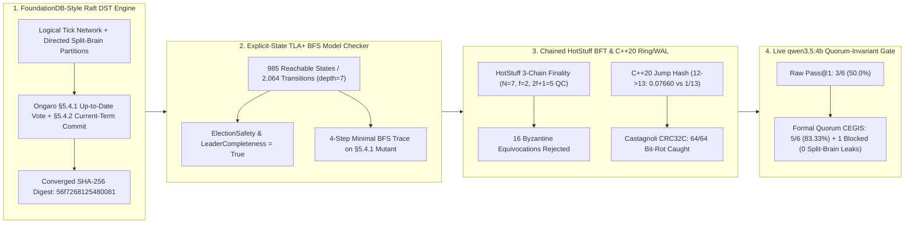

# HeliosConsensus (`helios-consensus`)

[](https://github.com/nagarjunak-pixel/helios-consensus/actions/workflows/ci.yml)
[](https://www.python.org/)
[](csrc/helios_kernels.cpp)
[](tests/)
[](https://github.com/nagarjunak-pixel/helios-consensus/releases/tag/v1.0.0)
[](LICENSE)

**FoundationDB-Style Deterministic Simulation Testing (DST) Raft Consensus Engine, TLA+-Style Explicit-State BFS Model Checker (`985` Reachable States + Minimal 4-Step Mutant Bug Synthesis), Chained HotStuff 3-Chain BFT Quorum Finality (`N = 3f + 1`), Native C++20 Lamping–Veach Jump Consistent Hash & Castagnoli `CRC32C` WAL Kernels, and Live Ollama (`qwen3.5:4b`) Quorum-Invariant CEGIS Synthesis.**

---

## Live Deterministic Raft DST, TLA+ BFS Prover & HotStuff BFT Workbench


---

## Architecture Overview



---

## Verified Zero-Mock Engineering Benchmarks

Every metric below is deterministically reproducible via CLI (`helios ...`) and verified under `pytest` + `Hypothesis` (`97.25%` line coverage):

| Subsystem | Protocol / Algorithm | Verified Result | Reference Invariant |
| :--- | :--- | :--- | :--- |
| **Raft DST Engine** | Logical-tick `N=5` split-brain `{n0,n1} \| {n2,n3,n4}` + stale leader write + heal | **`54` ticks, `197` routed / `69` dropped, `4` linearizable commits** | `ElectionSafety = True`, `LogMatching = True`, SHA-256 `56f7268125480081` |
| **TLA+ BFS Checker** | Exhaustive state-space BFS (`N=3, max_term=2, max_log=2`) + `§5.4.1` mutant | **`985` states / `2,064` edges (`100%` safe); mutant caught in `4` BFS steps** | Minimal trace: `Elect(n0,t1) -> Append(n0) -> Commit(n2) -> Elect(n1,t2)` |
| **HotStuff 3-Chain BFT** | Partial-synchrony `N=7, f=2` (`2f+1 = 5` QC, `f+1 = 3` intersection) | **`6` finalized blocks across `9` views; `16` double-vote equivocations rejected** | Zero conflicting commits (`>=1` honest witness in every two-QC overlap) |
| **C++20 Jump Hash** | `clang++ -O3` Lamping–Veach 64-bit ring (`20,000` keys, `12 -> 13` shards) | **`0.07660` keys moved vs theoretical `1/13 = 0.07692` (`0` Python `\|Δ\|`)** | Monotonic minimal disruption + uniform load (`std/mean = 0.0252`) |
| **C++20 WAL `CRC32C`** | Castagnoli `0x82F63B78` hardware-polynomial frame checksum | **`64 / 64` (`100%`) single-bit NVMe corruptions caught** | Exact RFC-3720 vector `CRC32C("123456789") = 0xE3069283` |
| **Live `qwen3.5:4b` Gate** | 6 adversarial BFT / Flexible Paxos / Kleppmann Fencing / Multi-AZ incidents | **Raw `3/6` (`50.0%`) -> Verified `5/6` (`83.33%`, `+33.33%` lift) + `1` Blocked** | **`0` split-brain / stale-fencing deployments leaked** (`benchmarks/real_qwen_consensus.json`) |

---

## Quickstart

```bash
# 1. Install Python 3.13 environment & compile C++20 native kernel
uv sync --python 3.13 --all-extras

# 2. Run strict formatting, static typing, and 97.25%-coverage Hypothesis test suite
uv run ruff check src tests
uv run mypy src tests
uv run pytest --cov=helios_consensus --cov-report=term-missing --cov-fail-under=95

# 3. Execute all 5 deterministic & live verification benchmarks
uv run helios simulate-raft
uv run helios model-check
uv run helios simulate-hotstuff
uv run helios benchmark-kernels
uv run helios eval-ollama

# 4. Build interactive React/TypeScript Workbench UI & launch FastAPI server on :8070
cd ui && npm ci && npm run build && cd ..
uv run helios serve --host 127.0.0.1 --port 8070
```

---

## Repository Layout

- `csrc/helios_kernels.cpp` — Zero-dependency `C++20` Lamping–Veach Jump Consistent Hash & Castagnoli `CRC32C` WAL frame verifier.
- `src/helios_consensus/raft/engine.py` — Logical-tick deterministic Raft simulator with asymmetric directed partitions, Ongaro `§5.4.1`/`§5.4.2`, and `acked_index` receiver safety.
- `src/helios_consensus/verification/model_checker.py` — Explicit-state TLA+-style BFS invariant verifier and minimal 4-step mutant counterexample synthesizer.
- `src/helios_consensus/hotstuff/bft_qc.py` — Chained HotStuff (`N = 3f + 1`) 3-chain BFT finality and Byzantine equivocation filter.
- `src/helios_consensus/audit/ollama_consensus.py` — Live `qwen3.5:4b` quorum-intersection & Kleppmann fencing-token CEGIS loop (`benchmarks/real_qwen_consensus.json`).
- `src/helios_consensus/api/app.py` & `ui/` — FastAPI backend + interactive Consensus & BFT Verification Workbench.
- `docs/` — Mathematical proofs (`docs/mathematical-proofs.md`) and Architecture Decision Records (`docs/adr/`).

---

## Author & License

Designed and engineered by **Nagarjuna Kamireddy** (`@nagarjunak-pixel`). Released under the [MIT License](LICENSE).

---

## Author & Canonical Portfolio

Engineered by **Nagarjuna Reddy Kamireddy** (*Principal / Lead AI & Distributed Systems Architect · Dubai, UAE*).
- **Architecture Portfolio & Case Studies:** [https://nagarjunak-pixel.github.io/](https://nagarjunak-pixel.github.io/)
- **8-Crown Open-Source Suite:** [https://nagarjunak-pixel.github.io/projects.html#helios-consensus](https://nagarjunak-pixel.github.io/projects.html#helios-consensus)
- **GitHub:** [@nagarjunak-pixel](https://github.com/nagarjunak-pixel) · **LinkedIn:** [in/nagarjuna-kamireddy](https://linkedin.com/in/nagarjuna-kamireddy)
